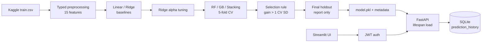

# House Price Prediction with Regularised and Ensemble Regression: A Reproducible Train-to-Serve Pipeline

> An end-to-end regression system that selects models under a pre-registered cross-validation rule and serves them through a JWT-authenticated FastAPI backend.

**Huỳnh Thị Ngọc Hoài — ML Engineer & Backend Developer**

**Core stack:** Python · scikit-learn · FastAPI · SQLAlchemy · Streamlit · Render

## Project Overview

On small tabular datasets, ensembles often edge out linear baselines by margins that sit inside cross-validation noise. Selecting a model on mean CV score alone therefore risks deploying added complexity with no real gain.

This project works on the Kaggle House Prices dataset with a log-transformed target. It compares Ridge, Random Forest, and Gradient Boosting under 5-fold CV and adopts a challenger only if it beats the incumbent by **more than one CV standard deviation**. The selected model is packaged as a versioned artifact and served through a JWT-authenticated FastAPI service with a Streamlit client.

## My Role and Contributions

- **Data and preprocessing:** EDA on missing values, outliers, encoding, and scaling; a typed scikit-learn preprocessing pipeline over 15 selected features.
- **Modelling:** linear and Ridge baselines, Ridge alpha tuning, and a Round 3 comparison of Random Forest, Gradient Boosting, and stacking.
- **Selection protocol:** a pre-registered switching rule (`ensemble_round3.passes_selection_threshold`) and an untouched final holdout used only for reporting.
- **Serving:** FastAPI auth and prediction routes, the model loaded once during the app lifespan, and `model_sha256` exposed on `/health`.
- **Persistence:** SQLAlchemy entities with audit fields, user-linked prediction history, and Alembic migrations.
- **Deployment and quality:** a Render Blueprint with build-time model packaging, request logging with redacted secrets, and a 128-test suite.

## System Architecture



Models can be swapped by replacing the versioned artifact and restarting the API. Routes and the Streamlit client stay unchanged.

## Technical Foundations

### 1. Log-target regression

`SalePrice` is right-skewed, so models train on `log1p(SalePrice)` and predictions are inverted with `expm1`. RMSE on the log scale penalises relative errors evenly across cheap and expensive houses. This matches the Kaggle metric.

### 2. Regularisation

Ridge adds an L2 penalty `α‖β‖²` that shrinks correlated coefficients and stabilises estimates on 1,168 training rows. Alpha is tuned with cross-validation inside the training portion only.

### 3. Ensembles

Random Forest averages decorrelated deep trees to reduce variance. Gradient Boosting fits shallow trees sequentially to the residuals to reduce bias. Twelve Gradient Boosting configurations were searched on the same folds used in the comparison.

### 4. Noise-aware model selection

A challenger replaces the incumbent only if:

```math
\overline{\mathrm{RMSE}}_{\text{incumbent}} - \overline{\mathrm{RMSE}}_{\text{challenger}} > \mathrm{SD}_{\text{incumbent}}
```

The rule is fixed before results are seen. The holdout split is made before CV and is read once at the end, so it never drives a model choice.

## Results

5-fold CV on 1,168 rows (log RMSE, mean ± SD):

| Model | CV RMSE (log) | Gain vs Ridge | Passes rule |
|---|---:|---:|:---:|
| **Ridge (α = 1.0)** | **0.158 ± 0.028** | — | selected |
| Random Forest (500 trees) | 0.159 ± 0.013 | −0.3% | no |
| Gradient Boosting (depth 2, 300 trees) | 0.146 ± 0.014 | +7.9% | no |

Gradient Boosting was 7.9% better than Ridge and won on all five folds. However, the 0.0125 gain stayed below Ridge's CV SD of 0.028, and the best-of-12 search makes the score mildly optimistic. **Ridge was retained.**

Final holdout (292 houses, report-only):

| Metric | Value |
|---|---:|
| R² (price) | **0.887** |
| MAE (price) | **$18.9K** |
| RMSE (price) | $29.5K |
| RMSE (log) | 0.153 |

Details: [`my-project/artifacts/final/README.md`](./my-project/artifacts/final/README.md) and [`my-project/artifacts/ensemble_round3/README.md`](./my-project/artifacts/ensemble_round3/README.md).

## Quick Start

### 1. Install

```powershell
python -m venv .venv
.\.venv\Scripts\Activate.ps1
pip install -r requirements.txt
pip install -e .
Copy-Item .env.example .env
alembic -c my-project/alembic.ini upgrade head
```

Set `SECRET_KEY` (at least 32 characters) in `.env`.

### 2. Get data and train

```powershell
python my-project/src/scripts/download_house_prices.py --destination my-project/data/raw
python -m ml.baseline_round2
python -c "from ml.ridge_tuning import run_ridge_tuning; run_ridge_tuning()"
python -m ml.ensemble_round3
python -m ml.finalize --allow-overwrite
```

The download uses `KAGGLE_API_TOKEN` or `~/.kaggle/access_token`. `ml.finalize` writes `my-project/model.pkl` and the holdout report under `my-project/artifacts/final/`.

### 3. Run the API and UI

```powershell
uvicorn api.main:app --app-dir my-project/src
python -m streamlit run my-project/src/streamlit_app/app.py
```

Open `http://localhost:8501`, register, and log in. API docs are at `http://127.0.0.1:8000/docs`.

| Route | Purpose |
|---|---|
| `POST /api/v1/auth/register` · `/login` | Create account / get JWT |
| `GET /api/v1/auth/me` | Current user |
| `POST /api/v1/predict` | Predict price (JWT required) |
| `GET /api/v1/predictions/history` | User prediction history |
| `GET /health` | Model status and `model_sha256` |

### 4. Swap the model

```powershell
python my-project/src/scripts/create_retrain_subset.py
python my-project/src/ml/train.py --data-path my-project/data/retrain/train_subset.csv
```

Restart Uvicorn. `/health` reports a new `model_sha256` with no route or UI changes.

### 5. Verify

```powershell
python -m pytest -q
python -m ruff check .
python -m black --check .
python -m mypy my-project/src
```

## Deployment

[`render.yaml`](./render.yaml) defines two free Render web services:

- `house-price-api`: downloads Kaggle data and packages `model.pkl` at build time, runs Alembic migrations, then starts Uvicorn.
- `house-price-ui`: the Streamlit client pointed at the API.

Required secrets: `SECRET_KEY` and `KAGGLE_API_TOKEN`. SQLite lives at `/tmp/app.db`, so users and history reset on restart. Free instances sleep when idle, so open both services a few minutes before a demo.

## Project Map

| Path | Responsibility |
|---|---|
| [`my-project/src/ml/`](./my-project/src/ml/) | Preprocessing, baselines, tuning, ensembles, finalisation |
| [`my-project/src/api/`](./my-project/src/api/) | FastAPI app, auth, prediction routes, request logging |
| [`my-project/src/models/`](./my-project/src/models/) | SQLAlchemy entities with audit fields |
| [`my-project/src/schemas/`](./my-project/src/schemas/) | Pydantic request/response contracts |
| [`my-project/src/streamlit_app/`](./my-project/src/streamlit_app/) | Login, prediction, history, and demo UI |
| [`my-project/alembic/`](./my-project/alembic/) | Database migrations |
| [`my-project/notebooks/`](./my-project/notebooks/) | EDA and model-training notebooks |
| [`my-project/tests/`](./my-project/tests/) | Test suite |

Generated data, artifacts, `app.db`, `model.pkl`, and `.env` are not committed.

